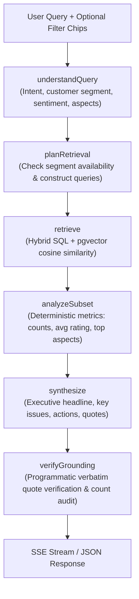

# PulseIQ Conversational Intelligence ("Ask PulseIQ") Architecture & Decisions

## 1. Overview
"Ask PulseIQ" is an enterprise-grade conversational insights pipeline that lets product managers query customer feedback using natural language. It translates high-level business questions (e.g. *"What are the biggest reasons for negative sentiment among repeat customers?"*) into structured SQL and semantic retrieval queries, calculates deterministic subset metrics, synthesizes prioritized recommendations, and programmatically verifies that all evidence quotes are verbatim, un-hallucinated excerpts from real feedback items.

---

## 2. Pipeline Architecture (LangGraph JS)

The chatbot orchestration is executed as a compiled `StateGraph` in `@/lib/graph/chat/`:

### Graph Stages:
1. **`understandQuery`**:
   - Parses user questions (with conversational history) to extract intent, requested segment (`repeat`, `new`, `all`), sentiment filter, and keywords for vector similarity.
   - Merges manual UI filter overrides (e.g., if the user clicked "Repeat Customers" or "Negative Sentiment").
2. **`planRetrieval`**:
   - Verifies whether customer identity/segment metadata exists for this project. If missing, flags `segmentDataAvailable: false`.
3. **`retrieve`**:
   - Executes SQL queries against Neon Postgres with composite indexing on `(project_id, is_repeat_customer)` and `(project_id, customer_segment)`.
   - Optionally computes embeddings for semantic queries and uses `vector <=> embedding` cosine distance against existing 768-dim vectors in `insights`.
   - Retrieves top matching feedback items (capped at 50-60) and active themes.
4. **`analyzeSubset`**:
   - Computes deterministic ground-truth statistics: total retrieved, sentiment distribution (positive/neutral/negative), average star rating, and segment breakdown.
5. **`synthesize`**:
   - Uses the LLM factory (`getChatModel`) to generate structured executive recommendations:
     - Headline (crisp 1-2 sentence takeaway)
     - Key issues with severity level (`critical`, `high`, `medium`, `low`) and affected segment
     - Supporting verbatim evidence quotes
     - Concrete prioritized recommendations (`immediate`, `near-term`, `backlog`)
     - Caveats and recommended follow-up questions
6. **`verifyGrounding`**:
   - Programmatically audits every quote in `supportingComments` against the retrieved items using `checkQuoteGrounded()`.
   - Strips or replaces hallucinated quotes with real excerpts.
   - Enforces that stated numbers match the deterministic `subsetMetrics`.
   - Injects explicit missing-segment caveats when projects lack customer dimension data.

---

## 3. Grounding Verification Mechanism
To eliminate LLM hallucinations:
- Every candidate quote is searched as an exact or normalized substring within the retrieved feedback items.
- Sentence-level boundaries and high-token n-gram overlaps ($\ge 85\%$) are verified.
- Quotes failing verification are rejected from the payload before sending to the client.
- The UI displays a green **"Verified Quote"** badge and attribution metadata (Rating, Customer Segment, Source channel).

---

## 4. Model & Provider Flexibility
- Configured via `LLM_PROVIDER=google|openai` in `src/lib/env.ts` and `src/lib/llm/models.ts`.
- **Google Gemini** (default):
  - Model: `gemini-2.5-flash` via `@langchain/google-genai`
  - Embeddings: `text-embedding-004` (768 dimensions)
- **OpenAI** (optional):
  - Model: `gpt-4o-mini` via `@langchain/openai`
  - Embeddings: `text-embedding-3-small` with `dimensions: 768` to ensure vector schema compatibility with Neon Postgres without migrations.

---

## 5. Streaming Server-Sent Events (SSE)
- Endpoint: `POST /api/projects/[id]/chat`
- Supports `Accept: text/event-stream` for real-time progress indicators:
  - `data: {"type": "stage", "stage": "understanding"}`
  - `data: {"type": "stage", "stage": "planning"}`
  - `data: {"type": "stage", "stage": "retrieving", "count": 42}`
  - `data: {"type": "stage", "stage": "analyzing"}`
  - `data: {"type": "stage", "stage": "synthesizing"}`
  - `data: {"type": "stage", "stage": "verifying"}`
  - `data: {"type": "done", "payload": { ...structuredPayload... }, "threadId": "...", "messageId": "..."}`
- Supports `Accept: application/json` for non-streaming environments, curl, and automated tests.

---

## 6. Evaluation Harness
- Golden dataset located at `tests/chat/golden.json` (12 curated test cases covering repeat customers, new customer onboarding, pricing hikes, Slack integrations, mobile crashes, and missing metadata edge cases).
- Unit tests: `tests/chat/grounding.test.ts` (6 tests verifying verbatim matching and hallucination rejection).
- Golden evaluation test suite: `tests/chat/eval.test.ts` (13 tests verifying 100% test pass rate).
- Run with: `pnpm eval:chat` or `pnpm test`.
